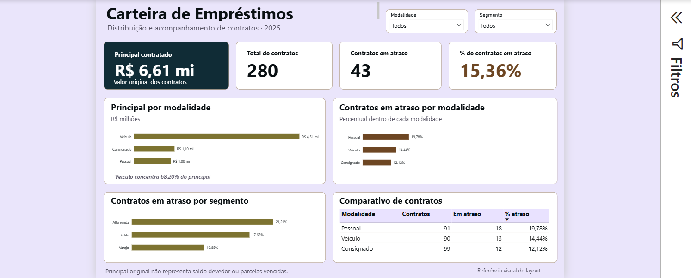
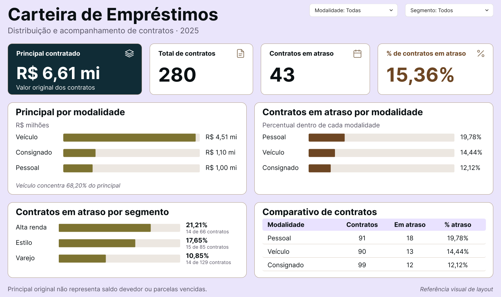

# Dashboard Banco Financeiro

Dashboard de **carteira de empréstimos**, desenvolvido no **Power BI Desktop**, com design de referência editável no **Figma** e dados fictícios para portfólio.



## Objetivo

Acompanhar a distribuição do principal contratado e dos contratos em atraso, com comparação por modalidade de empréstimo e segmento de clientes. A página considera contratações de **2025** e possui filtros interativos de **modalidade** e **segmento**.

## Indicadores

| Indicador | Resultado da base de referência |
|---|---:|
| Principal contratado | R$ 6.610.759,82 |
| Total de contratos | 280 |
| Contratos em atraso | 43 |
| Percentual de contratos em atraso | 15,36% |

O principal é o **valor original dos contratos**. Ele não representa saldo devedor, parcelas vencidas nem perdas. O percentual de atraso usa a quantidade de contratos, não o valor financeiro.

## Análises disponíveis

- Principal contratado por modalidade: Veículo, Consignado e Pessoal.
- Percentual de contratos em atraso dentro de cada modalidade.
- Percentual de contratos em atraso dentro de cada segmento: Alta renda, Estilo e Varejo.
- Tabela comparativa com total de contratos, contratos em atraso e percentual de atraso.
- Dicas de ferramenta com detalhes dos contratos e nota dinâmica de concentração em Veículo.

Na base de referência, Veículo concentra **68,20% do principal**. Pessoal apresenta a maior proporção de contratos em atraso entre as modalidades (**19,78%**). São observações descritivas sobre uma base fictícia, não conclusões causais.

## Dados e etapa de padronização

Os dois datasets estão incluídos no repositório:

| Arquivo | Finalidade |
|---|---|
| [Dataset original](dados/original/dataset_banco_financeiro.xlsx) | Base fornecida para o estudo. |
| [Dataset padronizado](dados/padronizado/banco_financeiro_padronizado.xlsx) | Versão produzida em uma etapa de validação e padronização com auxílio de uma skill, com a aba `Diagnostico`. |

As quatro tabelas contêm **650 clientes, 800 contas, 7.200 transações e 280 empréstimos**, totalizando **8.930 registros**.

A aba `Diagnostico` informa que **nenhuma alteração de conteúdo foi necessária**: os registros e totais foram preservados, sem ausentes, duplicatas exatas, IDs repetidos ou referências órfãs nas verificações registradas. A etapa é apresentada como verificação e padronização, sem atribuir correções que o diagnóstico não registra. O código e a identificação da skill usada nessa etapa não fazem parte dos materiais fornecidos.

Consulte o [dicionário dos dados](docs/dicionario-dados.md) e a própria aba de diagnóstico para os detalhes.

## Modelo e medidas

O projeto utiliza as views PostgreSQL `vw_clientes`, `vw_contas`, `vw_emprestimos` e `vw_transacoes`. As relações de negócio seguem o fluxo **Clientes → Contas → Empréstimos**, além de **Contas → Transações**. As medidas foram preservadas no modelo semântico e também estão documentadas em [medidas.dax](docs/medidas.dax).

```dax
Total Contratos =
DISTINCTCOUNT('public vw_emprestimos'[id_emprestimo])

Principal Contratado =
SUM('public vw_emprestimos'[principal_brl])

Contratos em Atraso =
CALCULATE(
    [Total Contratos],
    'public vw_emprestimos'[status_contrato] = "Em atraso"
)

% Contratos em Atraso =
DIVIDE([Contratos em Atraso], [Total Contratos], 0)
```

O filtro de segmento chega aos empréstimos pelas relações entre clientes e contas. As taxas são recalculadas no contexto dos filtros; não são somadas nem calculadas como média simples dos percentuais exibidos.

## Como abrir e reproduzir

1. Baixe o repositório completo ou faça um clone.
2. Abra [powerbi/BancoFinanceiro.pbip](powerbi/BancoFinanceiro.pbip) em uma versão do Power BI Desktop com suporte a projetos PBIP. Mantenha as pastas `.Report` e `.SemanticModel` ao lado do arquivo.
3. Para carregar os dados, configure um PostgreSQL local com o banco `banco_financeiro`. O projeto está configurado para `localhost:5432`.
4. Use o [guia de reprodução](docs/reproducao.md) para importar as tabelas da planilha padronizada e criar as views esperadas pelo modelo.
5. Informe suas próprias credenciais no Power BI Desktop e atualize os dados. Se usar outro servidor, porta ou nome de banco, ajuste as consultas no Power Query.

O GitHub apresenta os arquivos e as imagens do projeto; a navegação interativa do relatório ocorre no Power BI Desktop. O cache de dados e as credenciais locais não são versionados, portanto é necessário carregar a fonte ao abrir o projeto em outro computador.

## Design

O layout utiliza fundo lavanda, destaque escuro para principal contratado e barras em tons de oliva e marrom.

[Design editável no Figma](https://www.figma.com/design/7qtzQlUIUTfFenemgZpcsG?node-id=3-2) — acesso conforme as permissões do arquivo.

<details>
<summary>Ver composição do Figma</summary>



</details>

## Validação

O relatório foi aberto e conferido no Power BI Desktop. Os quatro indicadores principais e as aberturas por modalidade e segmento foram comparados com consultas DAX no modelo carregado. Os resultados agregados estão em [docs/validacao](docs/validacao).

## Estrutura

```text
dados/
  original/       # Dataset original em Excel
  padronizado/    # Dataset verificado e aba Diagnostico
docs/
  imagens/       # Capturas do Power BI e Figma
  validacao/     # Resultados agregados de conferência
  medidas.dax
  dicionario-dados.md
  reproducao.md
powerbi/
  BancoFinanceiro.pbip
  BancoFinanceiro.Report/
  BancoFinanceiro.SemanticModel/
scripts/
  exportar-csv.ps1
sql/
  estrutura-banco.sql
```

## Tecnologias e desenvolvimento

Power BI Desktop, DAX, Power Query (M), PostgreSQL, Excel e Figma. Projeto desenvolvido com apoio de ferramentas de IA para estruturação do relatório, design e documentação; os resultados foram conferidos no modelo.

**Autor:** [GU1LHO](https://github.com/GU1LHO)

**Dados inteiramente fictícios**, destinados a estudo e demonstração de habilidades de análise e visualização.
